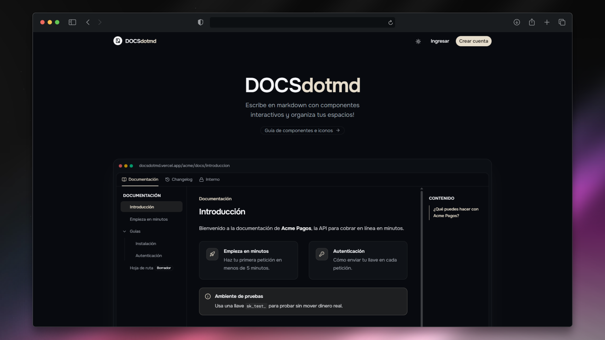

<div align="center">

# DOCSdotmd

**A private, modular documentation platform with a Markdown editor enriched with interactive visual components.**

Organize knowledge into spaces and pages with strictly private access, backed by a robust security architecture built on Row-Level Security (RLS).

[](https://docsdotmd.vercel.app)




</div>

## Table of Contents

- [Features](#features)
- [Tech Stack](#tech-stack)
- [Getting Started](#getting-started)
- [Available Scripts](#available-scripts)
- [Project Structure](#project-structure)
- [Markdown Components](#markdown-components)
- [Security and Privacy](#security-and-privacy)
- [Contributing](#contributing)

## Features

- **Organizations and spaces**: each organization groups its documentation into spaces (tabs), visible to the whole organization or only to specific groups.
- **Roles and permissions** (owner, admin, editor, reader) enforced in the database with Row Level Security: unauthorized access returns a **real 404**.
- **Markdown editor** with live preview, component insertion with `/` and local drafts.
- **Visual components**: steps, code tabs, callouts, accordions, cards, buttons and columns.
- **Instant full-text search** (`Ctrl + K`) that respects each user's permissions.
- **Private files**: images and PDFs served through signed links that expire in 60 seconds.
- **Email invitations** with single-use links that expire.
- **Public guide** at `/guia` with every component, its markdown, its rendered result and all available icons.
- **Responsive interface** with light and dark themes.

## Tech Stack

- **Next.js 16** (App Router) + **React 19** + strict **TypeScript**
- **Tailwind CSS 4** + shadcn/ui + typography
- **Supabase**: Auth, Postgres with RLS and private Storage, using `@supabase/ssr`
- **react-markdown** + remark-gfm + remark-directive + rehype-sanitize + rehype-slug
- **Shiki** (syntax highlighting) and **CodeMirror 6** (editor)
- **Zod** + react-hook-form, cmdk
- **Playwright** for renderer unit tests and e2e tests
- Package manager: **pnpm**

## Getting Started

### Installation

```bash
git clone https://github.com/MaickolRivera/docsdotmd.git
cd docsdotmd
pnpm install
```

### Configuration

1. **Database** (choose one):
   - **Local (Docker):** `pnpm db:start`, then `pnpm db:reset` (applies `supabase/migrations` and `supabase/seed.sql`).
   - **Cloud:** create a Supabase project, then run `pnpm supabase login`, `pnpm supabase link --project-ref <ref>` and `pnpm db:push` (add `--include-seed` for the demo data).
2. Copy `.env.example` to `.env.local` and fill in `NEXT_PUBLIC_SUPABASE_URL`, `NEXT_PUBLIC_SUPABASE_ANON_KEY` and `NEXT_PUBLIC_SITE_URL`.
3. In Supabase → Auth → URL Configuration, add `http://localhost:3000/**` and your production URL. Paste the templates from `supabase/templates/` into Auth → Email Templates (they use `token_hash`, so they work even if the link is opened in a different browser). To send more emails, set up a free SMTP provider (Resend).
4. Run `pnpm dev` and open `http://localhost:3000`.
5. Regenerate the types after every migration: `pnpm db:types` (local) or `pnpm db:types:linked`.

## Available Scripts

```bash
pnpm dev            # Development server
pnpm build          # Production build
pnpm lint           # ESLint
pnpm typecheck      # Next.js types + TypeScript
pnpm test:unit      # Markdown renderer tests
pnpm test:e2e       # e2e tests (require local Supabase; in CI they run with supabase start)
```

## Project Structure

```text
src/
├── app/
│   ├── (marketing)/      # Landing, public guide, privacy and terms
│   ├── (auth)/           # Login, sign-up and password recovery
│   ├── (app)/            # Organizations, spaces, pages, editor and settings
│   ├── api/adjuntos/     # Attachment delivery with signed links
│   └── auth/callback/    # Destination for email links
├── actions/              # Server Actions (auth, orgs, spaces, pages, members...)
├── components/           # UI: docs, editor, layout, settings, landing, ui (shadcn)
├── lib/
│   ├── markdown/         # Renderer pipeline and sanitization schema
│   ├── supabase/         # Browser and server clients, and the session proxy
│   ├── i18n/             # Interface strings
│   └── legal.ts          # Data policy and terms of use
├── proxy.ts              # Session, private routes and security headers (CSP)
└── types/                # Database types
supabase/
├── migrations/           # Schema, permission functions, RLS and storage
├── templates/            # Auth email templates
└── seed.sql              # Demo data
tests/                    # unit (renderer) and e2e
```

## Markdown Components

| Component | Syntax |
| --- | --- |
| Steps | `:::steps` with one `###` per step |
| Code tabs | `::::code-tabs` with blocks like `~~~js title="JavaScript"` |
| Callout | `:::callout{type="info\|tip\|warning\|danger" title="..."}` |
| Accordion | `:::accordion{title="..."}` |
| Card | `:::card{title="..." icon="rocket" href="/path"}` (icon list at `/guia`) |
| Button | `:button[Text]{href="/registro" variant="primary"}` |
| Columns | `::::columns` (separate columns with `***`) |
| Attachments | `` (inserted automatically when you paste or drag a file) |

Containers can be nested by always writing `::::`; the renderer adjusts the colons. Raw HTML and `javascript:` links are not allowed.

## Security and Privacy

- RLS enabled on every table, with no anonymous access and restricted editable columns.
- Private attachments bucket, with an access policy per organization and page.
- Markdown without raw HTML, plus CSP and protective headers.
- Data policy (`/privacidad`) and terms of use (`/terminos`) with explicit acceptance at sign-up. They are a baseline drafted with AI assistance, not legal advice: have a lawyer review them before launching with real users.

## Contributing

Contributions are welcome! If you want to add Markdown components, improve the editor or suggest features, open an issue or submit a pull request.

---

<div align="center">

Made with ❤️ by Maickol Rivera

</div>
