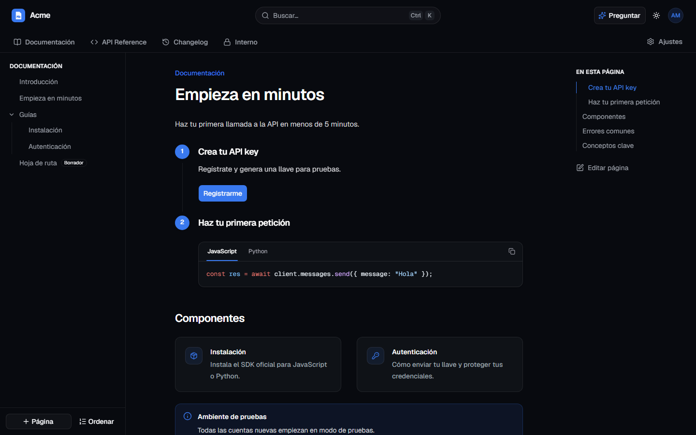
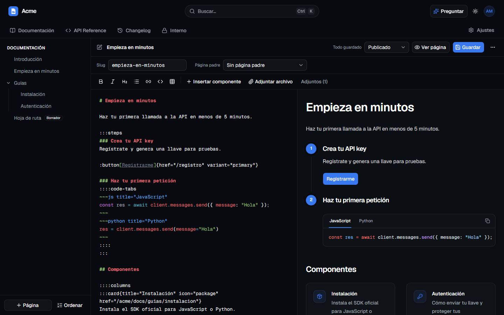
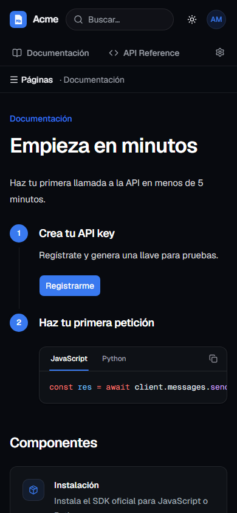

# DOCSmd

Plataforma de documentación privada tipo GitBook/Mintlify: cada **organización** tiene **espacios** (pestañas) con **páginas en markdown** y componentes visuales. Solo los miembros autorizados entran; los permisos viven en Postgres con RLS.

| Editor                                 | Móvil                                       |
| -------------------------------------- | ------------------------------------------- |
|  |  |

## Stack

Next.js 16 (App Router, TypeScript estricto) · Tailwind CSS 4 + shadcn/ui + typography · Supabase (Auth, Postgres con RLS, Storage privado) con `@supabase/ssr` · react-markdown + remark-gfm + remark-directive + rehype-sanitize + rehype-slug · Shiki · CodeMirror 6 · Zod + react-hook-form · cmdk · Playwright · pnpm.

## Puesta en marcha

1. `pnpm install`
2. Base de datos (elige una):
   - **Local (Docker):** `pnpm db:start` y luego `pnpm db:reset` (aplica `supabase/migrations` y `supabase/seed.sql`).
   - **Nube:** crea un proyecto en Supabase, `pnpm supabase login`, `pnpm supabase link --project-ref <ref>` y `pnpm db:push` (agrega `--include-seed` para los datos de demo).
3. Copia `.env.example` como `.env.local` y completa `NEXT_PUBLIC_SUPABASE_URL`, `NEXT_PUBLIC_SUPABASE_ANON_KEY` y `NEXT_PUBLIC_SITE_URL`.
4. En Supabase → Auth → URL Configuration agrega `http://localhost:3000/**` y la URL de producción. Pega las plantillas de `supabase/templates/` en Auth → Email Templates (usan `token_hash`, funcionan aunque el enlace se abra en otro navegador). Para más correos configura un SMTP gratuito (Resend).
5. `pnpm dev` y entra en http://localhost:3000
6. Regenera los tipos tras cada migración: `pnpm db:types` (local) o `pnpm db:types:linked`.

**Vercel:** las mismas variables de entorno y la región de las funciones igual (o lo más cerca posible) a la del proyecto de Supabase (Supabase → Project Settings → General). Cada página hace varias consultas seguidas a Supabase: si la app y la base están en la misma región, cada una tarda milisegundos en vez de ~200 ms. **GitHub:** secretos `SUPABASE_URL` y `SUPABASE_ANON_KEY` para el keep-alive.

### Usuarios de demo (`supabase/seed.sql`, contraseña `Demo-DOCSmd-2026`)

| Usuario          | Rol                                                                        |
| ---------------- | -------------------------------------------------------------------------- |
| ana@acme.test    | owner de Acme                                                              |
| eva@acme.test    | editora de Acme, grupo Ingeniería (edita el espacio restringido "Interno") |
| leo@acme.test    | lector de Acme                                                             |
| gina@globex.test | owner de Globex (grupo Finanzas)                                           |

## Componentes de markdown

| Componente         | Sintaxis                                                                       |
| ------------------ | ------------------------------------------------------------------------------ |
| Pasos              | `:::steps` con un `###` por paso                                               |
| Pestañas de código | `::::code-tabs` con bloques `~~~js title="JavaScript"`                         |
| Aviso              | `:::callout{type="info\|tip\|warning\|danger" title="..."}`                    |
| Acordeón           | `:::accordion{title="..."}`                                                    |
| Tarjeta            | `:::card{title="..." icon="rocket" href="/ruta"}` (lista de iconos en `/guia`) |
| Botón              | `:button[Texto]{href="/registro" variant="primary"}`                           |
| Columnas           | `::::columns` (separa columnas con `***`)                                      |
| Adjuntos           | `` (se insertan solos al pegar o arrastrar)               |

Los contenedores se pueden anidar escribiendo siempre `:::`: el renderizador ajusta los dos puntos. No se permite HTML crudo ni `javascript:`.

La **guía pública** (`/guia`, enlazada desde el editor y el menú de usuario) muestra cada componente con su markdown y su resultado, y todos los iconos con buscador. Está escrita con el mismo renderizador, así que también sirve de ejemplo de un proceso documentado.

## Scripts

`pnpm dev` · `pnpm build` · `pnpm lint` · `pnpm typecheck` · `pnpm test:unit` (renderizador) · `pnpm test:e2e` (requiere Supabase local; en CI corre con `supabase start`).

## Decisiones respecto a la especificación

- **Cache Components desactivado:** toda la app depende de la sesión y los accesos no autorizados deben responder **404 real**; con streaming el estado queda en 200.
- `group_members` y `space_groups` llevan `org_id`, con claves foráneas compuestas para que nunca se mezclen organizaciones. `profiles` guarda una copia del correo.
- Los adjuntos se sirven por `/api/adjuntos/[id]`, que valida permisos y redirige a un enlace firmado de 60 s (los PDF no caducan en la página abierta).
- Las invitaciones se envían con Resend si hay `RESEND_API_KEY`; si no, el enlace se muestra para copiarlo.
- Ordenar páginas: flechas subir/bajar (el plan B de la especificación) y cambio de página padre en el editor.
- **Identidad:** logo propio (`src/app/icon.svg`, también como favicon), tipografía **Onest** y color primario **hueso** en lugar del azul: `#e6ddcc` en el tema oscuro y un hueso tostado `#625240` en el claro, porque el hueso no se lee sobre blanco. Los enlaces del contenido van subrayados para no depender solo del color. Sin botón "Preguntar" (la IA queda fuera del MVP).
- `src/types/database.ts` se escribió con el formato de `supabase gen types`; regéneralo al conectar el proyecto.
